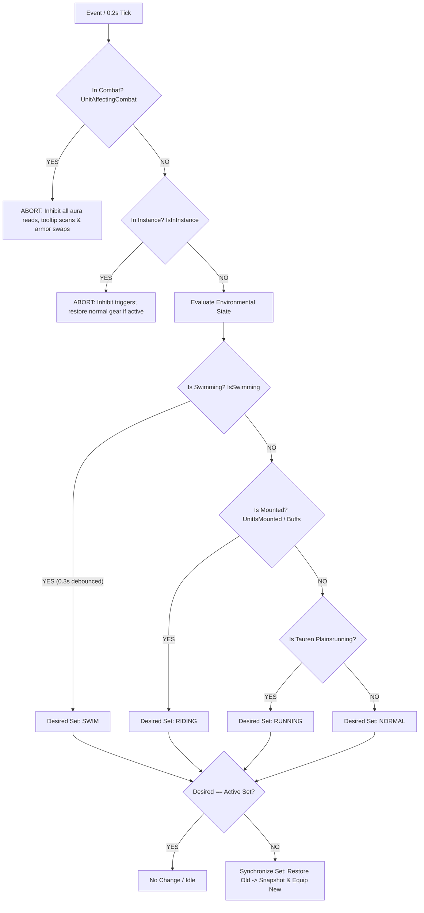

# OzGear Product Requirements Document (PRD)

> **Version**: 1.0.0  
> **Target Platform**: World of Warcraft 1.12.1 (Turtle WoW / Vanilla Client)  
> **Document Path**: `doc/PRD.md`  
> **Status**: Ready for Review  

---

### 1. Project Overview & Background

In World of Warcraft 1.12.1 (particularly Turtle WoW), players frequently transition between different movement states during exploration:
- **Mounting / Riding** (open-world travel)
- **Swimming / Diving** (water bodies, underwater caves, coastal quests)
- **Tauren Plainsrunning** (racial high-speed travel alternative to mounts)

Manually digging through bags to equip situational speed items (e.g., Carrot on a Stick, Riding Crop, Azure Silk Belt, Abyssal Walkers) and swapping them back is tedious. 

Furthermore, dual-wielding players frequently encounter severe issues when managing two weapons with the **exact same name** (e.g., two identical Dal'Rend's swords, Bone Slicing Hatchets, or identical daggers/axes, whether with different or identical enchantments). Most Vanilla equipment addons (like GBDSwitcher or naive macros) match items strictly by name, leading to selection collisions, wrong-hand equipping, or total failure when attempting to swap main hand and off hand.

### Core Objectives:
1. **Silent & Zero-Configuration**:
   - Zero manual setup required for swim and riding gear switches. No need to create manual "Sets" or bind events.
   - The addon automatically identifies special speed items in the player's bags and equips/restores them based on built-in catalog priorities.
   - Completely silent operation: no chat spam or screen clutter during swaps.
2. **Tauren Plainsrunning Support**:
   - Running speed gear is only beneficial for Tauren players using Plainsrunning (原野奔驰) as their travel mechanic. Non-Tauren players are filtered out via race check to prevent undesired gear swaps.
3. **Robust Dual-Wield Same-Name Weapon Swapping**:
   - Support seamless in-place swapping between Main Hand (Slot 16) and Off Hand (Slot 17), even when both weapons share the exact same name or item ID.
   - Accurately track bag instances via full ItemLink (`itemId:enchantId`) and bag coordinate pointers.
4. **Cleaned Item Database & Footwear Enchantments**:
   - Use items parsed from `doc/special gear list.md`.
   - Supports footwear enchantments (Thorium Spurs `61182` and Mithril Spurs `7969`) via event-driven lazy bag scanning (`BAG_UPDATE` dirty flag).
   - Explicitly omits multi-piece set bonuses (e.g., Primal Batskin, Elements Convergence) and consumable items (e.g., Swim Speed Potions).
5. **Combat Protection & Queue Engine**:
   - Allow instant weapon swaps during combat.
   - Queue armor/trinket swaps until leaving combat (`PLAYER_REGEN_ENABLED`) to prevent cursor lock or UI errors.

---

## 2. Reference Addons Evaluation & Architecture Selection

| Dimension | ItemRack | EN_AutoEquip | GBDSwitcher | YGB_HuanLianDao | **OzGear (Target Solution)** |
|---|---|---|---|---|---|
| **Code Footprint** | Extremely Heavy (~5,200 lines) | Medium (~800 lines) | Lightweight (~650 lines) | Lightweight (~1,200 lines) | **Ultra-Lightweight (~500 lines)** |
| **Same-Name Dual Wield** | Supported (via internal queue & slot locking) | Partially (`link:2` instance suffix) | Not supported (pure item name matching) | Not supported | **Full Support (3-step atomic cursor swap + link & bag slot tracking)** |
| **Auto Mount/Swim** | Supported (requires manual user Set & Event setup) | Not supported (manual sets only) | Not supported | Only gathers scythe/trinket | **Built-in & Fully Automatic (Zero config required)** |
| **In-Combat Queue** | Comprehensive combat queue | None | None | None | **Streamlined Combat Queue (Weapons immediate, armor deferred)** |
| **User Interface** | Heavy multi-window UI & complex menu bars | Character-sheet attached buttons | Custom frame with 10 specs | Standalone options panel | **Headless / Silent (Zero UI bloat, slash commands for debugging)** |

### Architectural Conclusion:
Adopt **EN_AutoEquip's clean slot-mapping foundation**, combined with **ItemRack's reliable environment detection (buff scanning, breath timer) and combat-safe queue mechanics**. Discard all UI frames, set configuration editors, and legacy baggage to build an ultra-focused, high-performance, silent gear switcher.

---

## 3. Functional Requirements

### 3.1 Feature 1: Auto Riding Gear Switch
- **Trigger Conditions**:
  - Player enters mounted state.
  - Detection method:
    1. Check `UnitIsMounted("player")` (if available on the client).
    2. Fallback buff texture inspection: look for textures containing `Mount_`, `inv_pet_speedy` (Turtle WoW's turtle mount), or tooltip scanning matching speed increase descriptions (`ItemRackText.MOUNTCHECK` pattern).
- **Execution**:
  - **Smart Trinket Slot Selection (`candidateSlots = {14, 13}`)**:
    - Avoids hardcoding Slot 14. Instead, evaluates candidate slots dynamically:
      1. **Keep Existing**: If the special trinket is already equipped in Slot 13 or 14, keep it in place.
      2. **Empty Slot Preferred (Score 100)**: If a slot is empty, fill it first.
      3. **On-Use Protection (Score 50 vs 10)**: Scans equipped trinket tooltips for active effects (`^使用：` or `^Use:`). Passive stat trinkets (e.g. Blackhand's Breadth, Hand of Justice) are replaced first. On-Use trinkets (e.g. Diamond Flask, Tidal Charm) are protected to avoid the 30-second cooldown penalty upon re-equipping.
  - Equip the highest-priority available riding items.
- **Restoration**:
  - When dismounting (mount buff disappears), restore the original equipment from the snapshot.
- **Riding Items Database & Candidate Hierarchy**:
  - **Trinkets (Candidate Slots: {14, 13})**:
    - `60501`: Riding Crop (鞭笞马鞭) - Priority 1
    - `11122`: Carrot on a Stick (棍子上的胡萝卜) - Priority 2
    - `50524`: Gnomish Racing Key (侏儒赛车钥匙) - Priority 3
    - `50525`: Goblin Racing Key (地精赛车钥匙) - Priority 4
  - **Feet (Slot 8 - Priority Order)**:
    - `61182`: **Thorium Spurs** (瑟银马刺, +7% mount speed) - **Priority 1** (Enchantment: attaches to any boots)
    - `58296`: **Boots of the Ooze-strider** (软泥行进之靴, +4% mount speed) - **Priority 2** (Item)
    - `7969`: **Mithril Spurs** (秘银马刺, +4% mount speed) - **Priority 3** (Enchantment: attaches to any boots)
- **Footwear Enchantment Detection & Lazy Scanning**:
  - **The Performance Problem**: Repeatedly inspecting tooltips for all bag items on every mount/dismount event (`UNIT_AURA`) causes visible FPS stutter in 1.12.
  - **The Solution (Event-Driven Dirty Flag with Lazy Scan)**:
    1. Listen to `BAG_UPDATE` and set `OzGear.Engine.isBagDirty = true`.
    2. Zero tooltip scanning occurs during steady-state travel or dismounting.
    3. When mounting, if `isBagDirty` is true, the engine evaluates bags once:
       - Items with `enchantId == 0` are skipped immediately (zero tooltip churn).
       - Items with matching `enchantId` (e.g. `464` for Mithril Spurs) match instantly.
       - Items requiring text validation check tooltip lines and self-cache the discovered `enchantId` for future instant checks.
       - Cache results in `OzGear.Engine.enchantCache` and clear `isBagDirty`.
    4. If the player is **already wearing** boots with the target spurs (e.g. raiding boots permanently spurred), OzGear recognizes the equipped enchant and skips swapping entirely.


---

### 3.2 Feature 2: Auto Swimming Gear Switch
- **Trigger Conditions**:
  - Player enters water / swimming state.
  - **Detection method (Independent of Breath Bar)**:
    - In Vanilla 1.12, the breath bar never appears when a player has Water Breathing buffs (Warlock's Unending Breath, Undead racial, Hydrocane, Elixirs) or when swimming on the surface.
    - Therefore, OzGear uses the **native client physics state API `IsSwimming()`** (returns `1` when in swim posture, `nil` otherwise) as the primary, authoritative detector via a responsive tick loop (0.2s interval).
    - Includes a **0.3s debounce filter** to prevent shoreline jumping or shallow-water wading from causing rapid equip jitter.
    - Also includes Druid Aquatic Form detection (`GetShapeshiftFormInfo`).
    - **Dungeon / Instance Safe-Mode**: Automatic detection is **completely disabled** when inside a party or raid instance (`IsInInstance()`), preventing unwanted gear switches during dungeon runs (e.g. BFD, Sunken Temple, Maraudon).
- **Execution**:
  - Snapshot current items in affected slots.
  - Equip best matching swim speed items from bags.
- **Restoration**:
  - When leaving water (`IsSwimming()` returns `nil` after debounce period) or entering an instance, restore previous items.
- **Swimming Items Database (Cleaned, No Sets/Potions)**:
  - **Trinkets (Candidate Slots: {14, 13})**:
    - `40061`: Tides Herald (雷瑟斯潮汐纹章)
    - `60470`: Ice Bead of Cage Noon (凯奇·努恩的冰珠)
    - `58079`: Pearlescent Shard (珠光碎片)
  - **Chest (Slot 5)**:
    - `83494`: Captain's Coat (船长大衣)
    - `42101`: Murloc Scale Breastplate (鱼人鳞片外套)
  - **Head (Slot 1)**:
    - `56023`: Gaze of the Abyss (深海的凝视)
  - **Waist (Slot 6)**:
    - `7052`: Azure Silk Belt (碧蓝丝质腰带)
  - **Feet (Slot 8)**:
    - `80720`: Abyssal Strider (深渊迈步者)
    - `65028`: Murloc Flippers (鱼人脚蹼)
  - **Two-Handed Weapon / Polearm (Slot 16 & 17)**:
    - `60860`: Halberd of Flowing Elements (流动元素之戟)

---

### 3.3 Feature 3: Tauren Plainsrunning Gear Switch
- **Race Check Requirement**:
  - Filter by `select(2, UnitRace("player")) == "Tauren"`.
  - Non-Tauren players completely bypass all running gear checks.
- **Trigger Conditions**:
  - Player activates Plainsrunning (原野奔驰, Buff texture `Spell_Nature_Swiftness`).
- **Execution**:
  - Snapshot original boots / polearm.
  - Equip running speed items (e.g., Boots of the Lynx Step `51284`, Defiler's / Highlander's boots, or Halberd of Flowing Elements `60860`).
- **Restoration**:
  - Restore original gear once Plainsrunning buff expires.

---

### 3.4 Feature 4: Same-Name Dual-Wield Weapon Swapping
- **The Core Problem**:
  - Dual-wielding Rogues/Warriors/Hunters often carry two weapons with the exact same name (e.g., two identical daggers or swords).
  - Common issues:
    1. Swapping Main Hand and Off Hand fails because addons see both slots already have "the item".
    2. Selecting a weapon from bag equips the wrong copy (e.g., equipping the Agility enchant weapon to Main Hand instead of Crusader).
- **Solution & Algorithms**:
  1. **In-Place Atomic 3-Step Cursor Swap**:
     - When swapping equipped Main Hand (16) and Off Hand (17):
       ```lua
       PickupInventoryItem(16) -- Pick up Main Hand to cursor
       PickupInventoryItem(17) -- Place Main Hand into Slot 17; Off Hand moves to cursor
       PickupInventoryItem(16) -- Place Off Hand into Slot 16
       ```
     - This operation is atomic, requires zero empty bag slots, and avoids name collisions entirely.
  2. **Bag Scanning by ItemLink & Unique Instance Slot**:
     - Parse full links: `|Hitem:(itemId):(enchantId):(suffixId):(uniqueId)|h[(name)]|h`.
     - Differentiate weapons by `enchantId` first.
     - If both weapons have identical ID and identical enchant, track items by physical location: `(bagId, slotId)` with instance index counter (Instance 1, Instance 2).
  3. **Slash Command**:
     - Provide `/ozg swap` or `/ozgear swap` to allow players to instantly swap their Main Hand and Off Hand weapons.

---

### 3.5 Feature 5: In-Combat Safety & Combat Queue
- **Rule in Vanilla 1.12**:
  - Weapons (Main Hand, Off Hand, Ranged) **CAN** be swapped during combat.
  - Armor and Trinkets **CANNOT** be swapped during combat.
- **Combat Aura Guard (Critical Performance & Safety Rule)**:
  - During combat, buffs/debuffs churn intensely (procs, DoTs, HoTs, auras, shouts).
  - To eliminate CPU waste and prevent illegal armor swap attempts, **all buff reading, tooltip scanning, and environmental auto-detection (swim, run, ride)** are strictly bypassed whenever `UnitAffectingCombat("player") == true`.
  - `PLAYER_AURAS_CHANGED` and `OnUpdate` immediately abort if the player is in combat.
  - Upon leaving combat (`PLAYER_REGEN_ENABLED`), the combat queue is flushed, and `OnAurasChanged()` is immediately triggered to cleanly re-evaluate movement state out of combat.
- **Mechanism**:
  - If a gear swap is triggered while `UnitAffectingCombat("player") == true`:
    - Weapon swaps execute immediately.
    - Armor / trinket swaps are pushed into `OzGear.CombatQueue`.
  - Listen for `PLAYER_REGEN_ENABLED` (leaving combat):
    - Flush `OzGear.CombatQueue` immediately and restore/equip pending items.

---

### 3.6 Silent Execution & Slash Commands
- **Silent Mode (Default)**:
  - No messages in `DEFAULT_CHAT_FRAME` during normal operations.
- **Slash Commands**:
  - `/ozg` or `/ozgear`: Show command list.
  - `/ozg swap`: Instantly swap Main Hand and Off Hand weapons.
  - `/ozg debug`: Toggle verbose debugging log messages in chat.
  - `/ozg status`: Print current detected state (Mount: on/off, Swim: on/off, Plainsrunning: on/off, Race: ...).

---

## 4. Trigger Mechanism & Environmental Lifecycle

The trigger system (`OzGear_Trigger.lua`) is the core perception engine of OzGear. It operates as a dual-layer state machine combining **event-driven instantaneous reactions** with **lightweight micro-tick polling (0.2s)** to provide responsive yet completely non-intrusive equipment management.



---

### 4.1 Dual-Layer Perception Architecture

Vanilla WoW 1.12 does not provide explicit events for all world interactions (e.g. there is no `PLAYER_ENTER_WATER` event). OzGear bridges this gap with a hybrid model:

1. **Event-Driven Instant Layer**:
   - `PLAYER_AURAS_CHANGED`: Immediately detects mount/dismount or buff changes without waiting for tick timers.
   - `PLAYER_ENTERING_WORLD` & `ZONE_CHANGED_NEW_AREA`: Immediately detects instance zoning or teleportation.
   - `PLAYER_REGEN_DISABLED`: Signals combat entry and instantly freezes environmental evaluations.
   - `PLAYER_REGEN_ENABLED`: Signals combat exit, immediately flushes delayed combat queues, and triggers a full state re-sync.
2. **Micro-Tick Polling Layer (0.2s OnUpdate)**:
   - Polls native physics states like `IsSwimming()` that do not fire aura events.
   - Provides a time-accumulator for debounce filtering.

---

### 4.2 Combat Guard Policy (Pre-Inspection Short-Circuit)

**The Problem**:
During combat, player auras churn continuously (e.g. HoTs, DoTs, Battle Shout, weapon procs, Crusader, poisons, trinket procs). Firing 24-buff scans and hidden tooltip line inspections on every aura change in combat causes severe CPU spikes, garbage collection pauses, and risk of illegal armor swap errors (attempting to swap armor in combat puts the item on the cursor and locks character actions).

**The Solution**:
- **Strict Pre-Condition**: Every detection function (`CheckMountedState()`, `CheckSwimmingState()`, `OnAurasChanged()`, `OnUpdate()`) evaluates `UnitAffectingCombat("player")` **before touching any auras or tooltips**.
- **Behavior in Combat**:
  - All aura reads, buff traversals, and tooltip parsing are **100% bypassed**.
  - All environmental gear auto-swaps (swim, ride, run) are **halted**.
  - Manual weapon swaps (`/ozg swap`) remain fully available, as weapons are legal to swap in combat.
- **Combat Exit Recovery**:
  - When `PLAYER_REGEN_ENABLED` fires, pending combat queue actions are executed, and `OnAurasChanged()` is immediately called out of combat to seamlessly resume detection.

---

### 4.3 Dungeon & Raid Safe-Mode Policy

**The Rule**:
Automatic environmental gear switching is **strictly prohibited inside PvE instances (5-man party dungeons and raid instances)** to protect combat gear during boss encounters and trash pulls.
*Note: Battlegrounds (`"pvp"`) and arenas (`"arena"`) are explicitly permitted*, as situational speed gear (e.g. boots, Carrot, mount speed) is a core component of PvP tactical play.

**Implementation**:
- Query `local inInstance, instanceType = IsInInstance()`.
- If `inInstance and (instanceType == "party" or instanceType == "raid")`:
  - Environmental checks immediately evaluate to `false` / `nil`.
  - If a player was wearing swim or riding gear upon entering the dungeon portal, the engine immediately calls `Restore()` to re-equip full combat gear.
  - Suppresses unwanted gear switching in water/mount dungeons (e.g. Blackfathom Deeps, Maraudon, Sunken Temple, Zul'Farrak, Temple of Ahn'Qiraj).

---

### 4.4 State Detection Specifications

| Movement State | Detection Mechanism | Safeguards & Filters |
|---|---|---|
| **Swimming (SWIM)** | Native client physics state `IsSwimming() == 1` (independent of breath bar; fully functional with Water Breathing buffs or on surface). Fallback to Druid Aquatic Form. | **0.3s Accurate Debounce**: `pendingSwimTime` resets to 0 on state change; requires sustaining swimming posture for >= 0.3s before triggering.<br>**Druid Guard**: Only checks shapeshift forms if player class is `DRUID`. |
| **Riding (RIDING)** | 1. Native `UnitIsMounted("player")` API.<br>2. **Single-Pass Texture Match**: `inv_pet_speedy` (Turtle WoW mount), `Mount_`, `QirajiCrystal_`.<br>3. **Throttled Tooltip Scan**: Throttled to at most once per 1.0s and wrapped in `pcall` for safety (`^提高速度` or `^Increases speed`). | Excludes `Spell_Nature_Swiftness` (Cheetah/Plainsrunning). Pre-checked by Combat Guard and Dungeon Guard before reading any buffs. Protected by `isSyncing` re-entrancy flag. |
| **Plainsrunning (RUNNING)** | 1. Race filter: `UnitRace("player") == "Tauren"`.<br>2. Buff icon: `Spell_Nature_Swiftness` with Plainsrunning speed description. | Non-Tauren players completely skip this check. Guarded by combat and instance checks. |

---

### 4.5 Priority Hierarchy & State Arbitration Matrix

When multiple environmental conditions overlap, OzGear enforces a strict, deterministic priority hierarchy:

$$\text{SWIMMING (Priority 1)} > \text{RIDING (Priority 2)} > \text{TAUREN RUNNING (Priority 3)} > \text{NORMAL (Default)}$$

#### Transition Arbitration Table

| Current Active State | New Environmental Event | Action Taken | Resulting Active State |
|---|---|---|---|
| **NORMAL** | Mounts up in open world | Snapshot original gear -> Equip Riding items | **RIDING** |
| **RIDING** | Dismounts in open world | Restore original gear -> Clear snapshot | **NORMAL** |
| **RIDING** | Falls into deep water / starts swimming | Restore Riding gear -> Snapshot original -> Equip Swim items | **SWIM** |
| **SWIM** | Climbs out of water onto land | Restore original gear -> Clear snapshot | **NORMAL** |
| **SWIM** | Climbs onto land while still mounted (Turtle Mount) | Restore Swim gear -> Snapshot original -> Equip Riding items | **RIDING** |
| **ANY** | Enters Dungeon / Raid portal | Force `Restore()` -> Suppress all auto-triggers | **NORMAL** |
| **ANY** | Enters Combat | Halt all auto-triggers; defer any pending swaps | **CURRENT (Frozen)** |
| **CURRENT (Frozen)** | Leaves Combat (`PLAYER_REGEN_ENABLED`) | Flush Combat Queue -> Re-evaluate current environment | **Evaluated State** |

---

### 4.6 Snapshot & Restoration Lifecycle

1. **Post-Swap Atomic Snapshotting**:
   - The original equipment is recorded strictly **AFTER** a swap succeeds (`SwapBagToInv == true`), preventing corrupted rollback state if an equip action fails.
   - **Empty Slot Sentinel (`EMPTY_SLOT = "__EMPTY__"`)**: If an inventory slot was originally empty, `EMPTY_SLOT` is stored rather than `nil`. In Lua, table keys with `nil` values are discarded, which would prevent `pairs()` traversal from ever unequipping the item.
2. **Resilient Invertible Restoration**:
   - When transitioning out of a special state, the engine queries the snapshot table:
     - **For `EMPTY_SLOT`**: The speed gear is unequipped back to bags using `PutCursorItemInBags(slotId)`. If all bags are 100% full, the item is safely returned to `slotId` to avoid cursor lock or item loss.
     - **For `originalLink`**: The engine queries bags via `FindExactLinkInBags(originalLink)` and swaps it back into place.
   - **Granular Cleanup**: Only successfully restored slots are evicted from the snapshot table. If an unequip or swap fails (e.g. inventory temporarily locked or full), the slot remains in `snapshot` so the subsequent restore cycle can self-heal without state loss.
   - Once all slots are confirmed restored, `activeTrigger` is reset to `nil`.

---

### 4.7 Slot-Grouped Organization & Candidate Architecture

To eliminate runtime CPU overhead and garbage generation during equipment changes, the gear database is partitioned and sorted **strictly by equipment slot / category** (`OzGear.Data.SwimSlots`, `OzGear.Data.RidingSlots`), with candidates sorted in descending priority order:

1. **Unified Candidate Structure (ITEM & ENCHANT)**:
   - Slots support both direct items (`type = "ITEM"`) and enchantments (`type = "ENCHANT"`).
   - For example, Feet (Slot 8) in Riding set evaluates:
     1. `Thorium Spurs` (`type = "ENCHANT", id = 61182`, +7%)
     2. `Boots of the Ooze-strider` (`type = "ITEM", id = 58296`, +4%)
     3. `Mithril Spurs` (`type = "ENCHANT", id = 7969`, +4%)
2. **Early-Exit Bypass (Zero Bag Scans)**:
   - When evaluating a slot group (e.g. Feet Slot 8), the engine first checks the currently equipped item against the slot's top candidate.
   - If the player is **already wearing** the highest-priority candidate (e.g. boots already enchanted with Thorium Spurs), the entire slot evaluation terminates immediately (`return`). Bag scanning and swapping are completely skipped.
3. **Priority-Break (Dodge Lower-Priority Items)**:
   - If the slot does not currently have the top candidate, candidates are queried strictly in descending priority order.
   - As soon as the first matching owned candidate is found and equipped, the loop executes a `break` statement.
   - Lower-priority candidates are **never queried in bags**, minimizing bag traversals.
4. **Unified Single-Pass Bag Scan (Dirty Flag)**:
   - `BAG_UPDATE` sets `isBagDirty = true`.
   - When dirty, a single traversal across bags 0–4 parses each item link once, extracting and indexing **both `itemId` and `enchantId` simultaneously** into memory (`bagCache.items` and `bagCache.enchants`).
   - Subsequent queries for any items or enchantments (including candidate boots and trinkets) execute as instant $O(1)$ table lookups with zero redundant bag traversals.
   - Zero tooltip churn during aura polling or dismounting; items with `enchantId == 0` skip tooltips completely.
5. **Dual Trinket Group Allocation**:
   - For candidate trinket slots (`{14, 13}`), if the player owns multiple distinct speed trinkets (such as both Gnomish Racing Key and Goblin Racing Key, or Carrot on a Stick + Racing Key), OzGear dynamically equips up to 2 speed trinkets across both slots 14 and 13.
   - If the player owns only 1 speed trinket, it is equipped into the single optimal slot (Empty > Passive > On-Use), leaving the other slot untouched.
   - If 1 speed trinket is already equipped and another unused speed trinket is in bags, the second trinket is equipped into the remaining candidate slot.
   - Early exit triggers when all candidate slots (`table.getn(candidateSlots) == 2`) are already fitted with speed trinkets.

---

### 4.8 Client 1.12 Compatibility & Cursor Safety Invariants

1. **ItemLink Pattern Parsing (1.12 vs SuperWoW)**:
   - Native 1.12 item links follow `|c...|Hitem:itemId:enchantId:suffixId|h[Name]|h|r` (3 numerical segments, without `uniqueId`).
   - `ParseItemLink` uses a multi-tier pattern cascade:
     - Tier 1: 4-segment pattern (`item:(%d+):(%d+):(%d+):(%d+).-%[(.-)%]`) for SuperWoW / TBC+ forward compatibility.
     - Tier 2: 1.12 permissive pattern (`item:(%d+):?(%d*):?(%d*).-%[(.-)%]`) accepting 1 to 3 segments and optional colons without loss of `enchantId` or `suffixId`.
     - Tier 3: Short fallback (`item:(%d+).-%[(.-)%]`).
2. **Zero Item-Loss Cursor Stow Policy**:
   - In WoW 1.12, calling `ClearCursor()` while an item is picked up on the cursor will permanently destroy or drop the item.
   - `ClearCursor()` on items is strictly prohibited. When an item is on the cursor, `PutCursorItemInBags(fallbackInvSlot)` is executed:
     - Tries Backpack (`bag 0` via `PutItemInBackpack()`).
     - Tries Bag Containers `1..4` via explicit 1.12 inventory IDs (`{ [1]=20, [2]=21, [3]=22, [4]=23 }`).
     - Scans open slots with `GetContainerItemInfo`.
     - Fail-safe fallback: If all bags are 100% full, the item is restored directly into `fallbackInvSlot` with an error message, never discarded.
3. **Two-Tier Bag Matching (`FindExactLinkInBags`)**:
   - In order to prevent incorrect gear matching when players have multiple items of the same ID but different enchantments:
     - **Tier 1 (Exact Link)**: Direct string equality `link == targetLink` immediately matches.
     - **Tier 2 (Same Enchant)**: If string differs (e.g. slight color tag difference), searches for `itemId == targetItemId and enchantId == targetEnchant`.
     - **Tier 3 (Same ID)**: General fallback to same item ID only if no same-enchant match exists in bags.
4. **Weapon Swap Post-Verification & Tooltip Scanning**:
   - `SwapEquippedWeapons()` takes pre-swap snapshots of MainHand and OffHand links, executes the 3-step atomic swap, and validates `newMH == origOH and newOH == origMH` with rollback protection.
   - Tooltip On-Use detection searches for `"使用："` / `"使用:"` / `"Use:"` anywhere in the line text, accommodating color codes and multiline text.
   - Global `OzGearScanTooltip` is instantiated once and safely shared across modules.

---

## 5. Excluded Elements (Per Explicit Instructions)

1. **Set Bonuses Omitted**:
   - `Primal Batskin` (19685, 19687, 19686) - Excluded.
   - `Elements Convergence` (65024, 65025, 65026, 65027) - Excluded.
2. **Consumable Potions Omitted**:
   - `6372`: Swim Speed Potion (速游药水) - Consumable, excluded.  
   *(Note: Footwear enchantments Thorium Spurs 61182 and Mithril Spurs 7969 are fully supported via the candidate enchant engine).*

---

## 6. File & Module Structure

```
OzGear/
├── OzGear.toc             -- Addon manifest & load order
├── OzGear.lua             -- Entry point, environment detection, slash commands
├── Data.lua               -- Central constant registry (slots, colors, special gear catalogs)
├── EventBus.lua           -- Perception dispatcher (physics, auras, instances, combat)
├── SetTracker.lua         -- Inventory cache & atomic cursor swap engine
├── WorkHorse.lua          -- Rule engine, slot snapshotting, restore & combat queue
├── Glow.lua               -- Quality & durability border glow overlays for character/inspect
├── ScannerData.lua        -- Bilingual token dictionary, equip patterns, and iLvl catalog
├── Scanner.lua            -- Equipment stats scanner & 4-tier item level calculator
├── StatsUI.lua            -- In-place character/inspect avg iLvl badges & stats breakdown tooltip
└── horses/                -- Domain horses
    ├── riding.lua         -- Riding gear handler
    ├── swimming.lua       -- Swimming gear handler
    ├── plainrunning.lua   -- Tauren travel form handler
    └── dualwield.lua      -- Dual-wield same-name weapon swap
```

---

## 7. Implementation Roadmap

1. **Phase 1 (Design Review)**: Finalize `doc/PRD.md`.
2. **Phase 2 (Database & Utils)**:
   - Implement `OzGear_Data.lua` with validated item IDs and slot metadata.
   - Implement `OzGear_Utils.lua` with ItemLink extraction, duplicate item tracking, and atomic swap helpers.
3. **Phase 3 (Swap Engine & Combat Queue)**:
   - Implement `OzGear_Engine.lua` for slot snapshotting, safe equipping, restoration, and combat queue handling.
4. **Phase 4 (State Triggers & Integration)**:
   - Implement `OzGear_Trigger.lua` for mount/swim/Plainsrunning detection.
   - Assemble `OzGear.lua` and `OzGear.toc`.
5. **Phase 5 (Testing & Edge Case Handling)**:
   - Validate dual identical weapon swap.
   - Test bag full condition, combat transitions, and silent execution.
