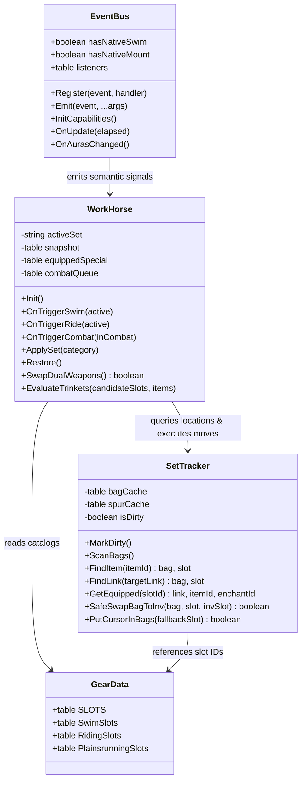
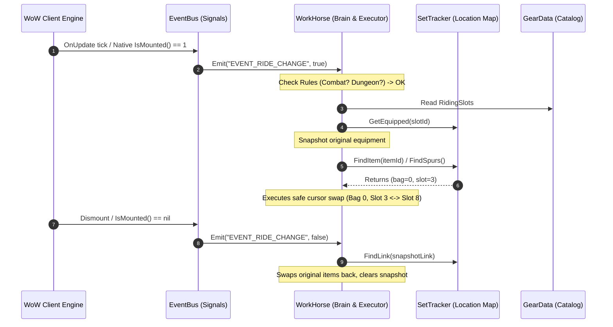

# OzGear Refactoring Plan: 4-Class Architecture

> **Document**: `plan.md`  
> **Target Platform**: World of Warcraft 1.12.1 (Turtle WoW / Vanilla Client & SuperWoW)  
> **Status**: Draft / Ready for Review  

---

## 1. Objectives & Architectural Shift

The current OzGear codebase distributes responsibilities across tightly coupled modules (`OzGear`, `Engine`, `Trigger`, `Utils`, `Data`), where `Trigger` drives `Engine`, bag caching is mixed with swap logic, and feature code like weapon swapping is placed in a generic utility file.

We refactor this into a clean **4-class / 4-module architecture**:
1. **`EventBus`**: Abstracted event aggregator and signal generator (independent of gear concepts).
2. **`SetTracker`**: Physical inventory and coordinate map (resolving WoW 1.12 dual-wield and item identity limitations).
3. **`WorkHorse`**: The central brain, rule engine, snapshot manager, and swap executor.
4. **`GearData`**: Pure declarative catalog of items, slots, and priorities.

---

## 2. SuperWoW 2.2 Detection & Capabilities

SuperWoW exposes `SUPERWOW_VERSION` to the global Lua environment.

```lua
local function GetSuperWoWVersionNumber()
    if not SUPERWOW_VERSION then return 0 end
    local major, minor = string.match(tostring(SUPERWOW_VERSION), "(%d+)%.?(%d*)")
    return tonumber(major or 0) + (tonumber(minor or 0) / 10)
end
local isSuperWoW22 = GetSuperWoWVersionNumber() >= 2.0
```

### Feature Matrix by Client Environment

| Environment               | Swimming Detection                                                   | Riding Detection                                               | Tooltip Scanning Impact                                                  |
| ------------------------- | -------------------------------------------------------------------- | -------------------------------------------------------------- | ------------------------------------------------------------------------ |
| **SuperWoW $\ge$ 2.0**    | Native `IsSwimming()`                                                | Native `IsMounted()`                                           | **0% Tooltip Scans** during state checks. Instant, zero CPU cost.        |
| **Legacy 1.12 / Vanilla** | **Feature Dropped** *(No breath bar polling, zero shoreline jitter)* | Fast texture matching with throttled/memoized tooltip fallback | Tooltip scanned **only on aura change** and cached. Zero OnUpdate scans. |

---

## 3. Tooltip Scanning Mitigation Strategy

In Vanilla 1.12, continuous or multi-item tooltip scanning causes severe client micro-stutters. We enforce three strict rules:

1. **Zero Tooltip Scans in the `OnUpdate` Loop**:
   - `OnUpdate` handles only tick timers and native physics polling when SuperWoW $\ge$ 2.2 is present.
   - Legacy clients never touch `GameTooltip` inside `OnUpdate`.
2. **Buff Scanning for Mount Detection**:
   - **Fast Texture Scan First**: 95%+ of mounts match texture names (`Mount_`, `inv_pet_speedy`, `QirajiCrystal_`).
   - **Memoized Aura Cache**: Once a buff icon is checked, cache `[buffTexture] = isMount` to bypass tooltips for all future occurrences.
   - **Event-Driven Only**: Run only on `PLAYER_AURAS_CHANGED`, never continuously.
3. **Footwear Spurs Scanning (Bags)**:
   - **Enchant ID Direct Match**: Mithril Spurs (`enchantId == 464`) require zero tooltip scanning.
   - **Enchant ID Discovery Cache**: If a boot requires a text search for "Thorium Spurs", once discovered, cache its `enchantId` or link so it is never tooltip-scanned again.
   - **Dirty Flag**: Bag scans run only when `BAG_UPDATE` marks the bag dirty, and only when a swap is actually needed.

---

## 4. Class Design & Responsibilities



### 4.1 Class 1: `EventBus` (`EventBus.lua`)
* **Role**: Signal Generator & Subscriber Hub.
* **Knowledge**: Knows **nothing** about equipment slots, item IDs, or gear sets.
* **Responsibilities**:
  - Checks client capabilities (`SUPERWOW_VERSION >= 2.0`).
  - Registers raw Blizzard frame events (`PLAYER_AURAS_CHANGED`, `PLAYER_REGEN_DISABLED`, `PLAYER_REGEN_ENABLED`, `ZONE_CHANGED_NEW_AREA`, `BAG_UPDATE`).
  - Translates raw events and physics polling into semantic signals:
    - `EVENT_SWIM_CHANGE (isActive)` *(SuperWoW $\ge$ 2.0 only)*
    - `EVENT_RIDE_CHANGE (isActive)`
    - `EVENT_COMBAT_CHANGE (inCombat)`
    - `EVENT_BAGS_UPDATED ()`
    - `EVENT_ZONE_CHANGED (inDungeon)`
  - Provides `Register(event, handler)` and `Emit(event, ...)`.

### 4.2 Class 2: `SetTracker` (`SetTracker.lua`)
* **Role**: Physical Inventory & Bag Coordinate Map.
* **Knowledge**: Knows bag structures, item links, enchantments, and physical slot coordinates.
* **Responsibilities**:
  - Tracks physical `(bag, slot)` coordinates for items and weapons.
  - Resolves dual-wield same-name identity using exact item link matching (`itemId:enchantId:suffixId`).
  - Manages bag scanning with dirty-flag caching (`EVENT_BAGS_UPDATED`).
  - Implements cursor-safe swap primitives (`SafeSwapBagToInv`, `PutCursorInBags`) so items are never dropped or left on the cursor.
  - Manages spur enchantment caching to eliminate tooltip churn.

### 4.3 Class 3: `WorkHorse` (`WorkHorse.lua`)
This should be a factory, it have a table of horses, each of the horse own a task, they should be put into seperate file like `riding.lua`, `swimming.lua`, `dualwield.lua` etc and extend it in `WorkHorse.horses["Riding"]`, `WorkHorse.horses["Swimming"]` etc. and in order to not let horses to hook on too much events, in `WorkHorse`, we should maintain a `evn` data sheet this `env` shall be in OzGear but not stored in WorkHorse. including `in_combat`, `is_swimming`, `is_riding`, `is_dungeon`, `is_raid`, `is_super_wow_20`, `is_plainrunning`, `is_rogue`
* **Role**: Central Brain, Rule Engine, & Swap Executor.
* **Knowledge**: Knows gear states, candidate scoring, combat rules, and equipment snapshots.
* **Responsibilities**:
  - Subscribes to `EventBus` signals.
  - **Rule Chain Evaluation**:
    1. Dungeon / Raid Safe-Mode $\rightarrow$ Force restore / bypass all auto-swaps.
    2. Combat Active $\rightarrow$ Defer non-weapon swaps to `combatQueue`.
    3. Swimming State $\rightarrow$ Apply `SwimSlots` (SuperWoW $\ge$ 2.2).
    4. Riding State $\rightarrow$ Apply `RidingSlots`.
    5. Normal State $\rightarrow$ Restore original snapshot.
  - **Snapshot & Rollback**: Records unequipped items (with `__EMPTY__` sentinel) and restores them gracefully upon state exit.
  - **Smart Trinket Placement**: Dynamically scores candidate slots {14, 13} to prioritize empty slots and passive trinkets, protecting active On-Use trinket cooldowns.
  - **Atomic Weapon Swapper**: Orchestrates the 3-step atomic cursor swap between Slot 16 and Slot 17.

### 4.4 Class 4: `GearData` (`Data.lua`)
* **Role**: Pure Declarative Catalog.
* **Knowledge**: Static table definitions with zero procedural code.
* **Contents**:
  - `SLOTS` enum (Head=1, Feet=8, MainHand=16, OffHand=17, etc.).
  - `SwimSlots` (grouped by slot, sorted by priority).
  - `RidingSlots` (spurs enchantments, boots, riding trinkets).
  - `PlainsrunningSlots` (Tauren-specific boots/polearm).

---

## 5. Interaction Workflow



---

## 6. Phased Implementation Roadmap

### Phase 1: Pure Data & Capability Foundation
1. Refactor `OzGear_Data.lua` to ensure clean declarative tables for `SwimSlots`, `RidingSlots`, `PlainsrunningSlots`, and `SLOTS`.
2. Implement `OzGear_EventBus.lua`:
   - Feature detection: checks `SUPERWOW_VERSION >= 2.2`.
   - Setup publisher/subscriber registry (`Register`, `Emit`).
   - Implement `IsMounted` (native for SuperWoW $\ge$ 2.2, or memoized buff check).
   - Implement `IsSwimming` (native for SuperWoW $\ge$ 2.2, disabled for legacy).
   - Emit clean events.

### Phase 2: Inventory & Coordinate Tracking (`SetTracker`)
1. Implement `OzGear_SetTracker.lua`:
   - Port link parser from `OzGear_Utils.lua`.
   - Port bag scanning and dirty flag from `OzGear_Engine.lua`.
   - Port cursor safety primitives (`PutCursorItemInBags`, `SwapBagToInv`).
   - Add dual-wield weapon coordinate queries (`FindExactLinkInBags`).
   - Subscribe `SetTracker` to `EventBus:Register("EVENT_BAGS_UPDATED")`.

### Phase 3: Brain & Swap Engine (`WorkHorse`)
1. Implement `OzGear_WorkHorse.lua`:
   - Subscribe to `EventBus` (`EVENT_SWIM_CHANGE`, `EVENT_RIDE_CHANGE`, `EVENT_COMBAT_CHANGE`, `EVENT_ZONE_CHANGED`).
   - Port snapshot & restore logic from `OzGear_Engine.lua`.
   - Port candidate trinket scoring logic ({14, 13} On-Use protection).
   - Port combat queue idempotency.
   - Port atomic 3-step weapon swap (`SwapDualWeapons`).

### Phase 4: Main Facade & TOC Integration
1. Update `OzGear.toc` to load files in strict dependency order:
   ```toc
   Bindings.xml
   OzGear_Data.lua
   OzGear_EventBus.lua
   OzGear_SetTracker.lua
   OzGear_WorkHorse.lua
   OzGear.lua
   ```
2. Refactor `OzGear.lua` to be a thin facade:
   - Handle slash commands (`/ozg swap`, `/ozg status`, `/ozg debug`, `/ozg ride`, `/ozg restore`).
   - Hook keybindings to `WorkHorse`.
   - Delete obsolete `OzGear_Trigger.lua`, `OzGear_Engine.lua`, and `OzGear_Utils.lua` once all functionality is verified.

---

## 7. Verification Checklist

- [ ] **SuperWoW 2.0 Check**: `/ozg status` reports whether SuperWoW 2.2 was detected and which detection engines (Native vs Legacy) are active.
- [ ] **Legacy Fallback**: If running without SuperWoW 2.2, swimming auto-swap is cleanly disabled; riding auto-swap works via cached buff textures without continuous tooltip scanning.
- [ ] **Dual-Wield Weapon Swap**: Swapping two weapons with the exact same name or ID works with zero bag requirements and zero desyncs.
- [ ] **Combat Safety**: Entering combat suppresses auto-equipping; leaving combat flushes pending swaps via the combat queue.
- [ ] **Resilient Restore**: If bags are full when dismounting/surfacing, original items stay tracked in snapshot rather than being lost.
